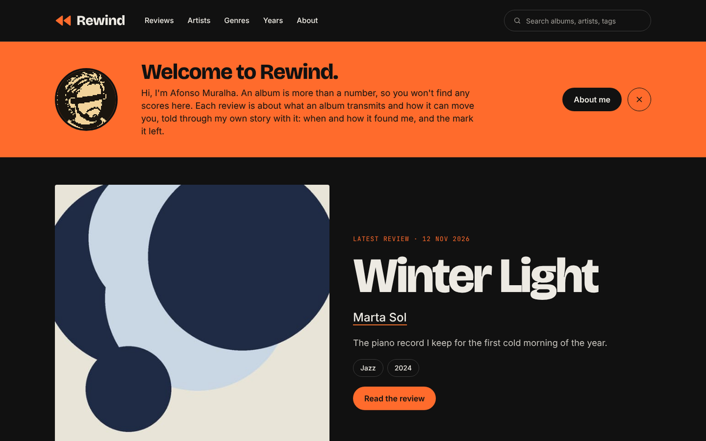
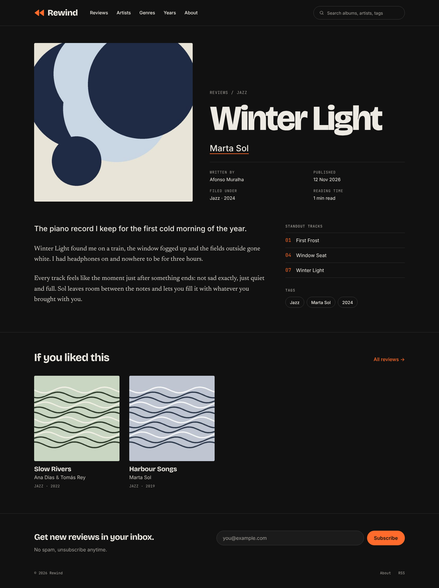
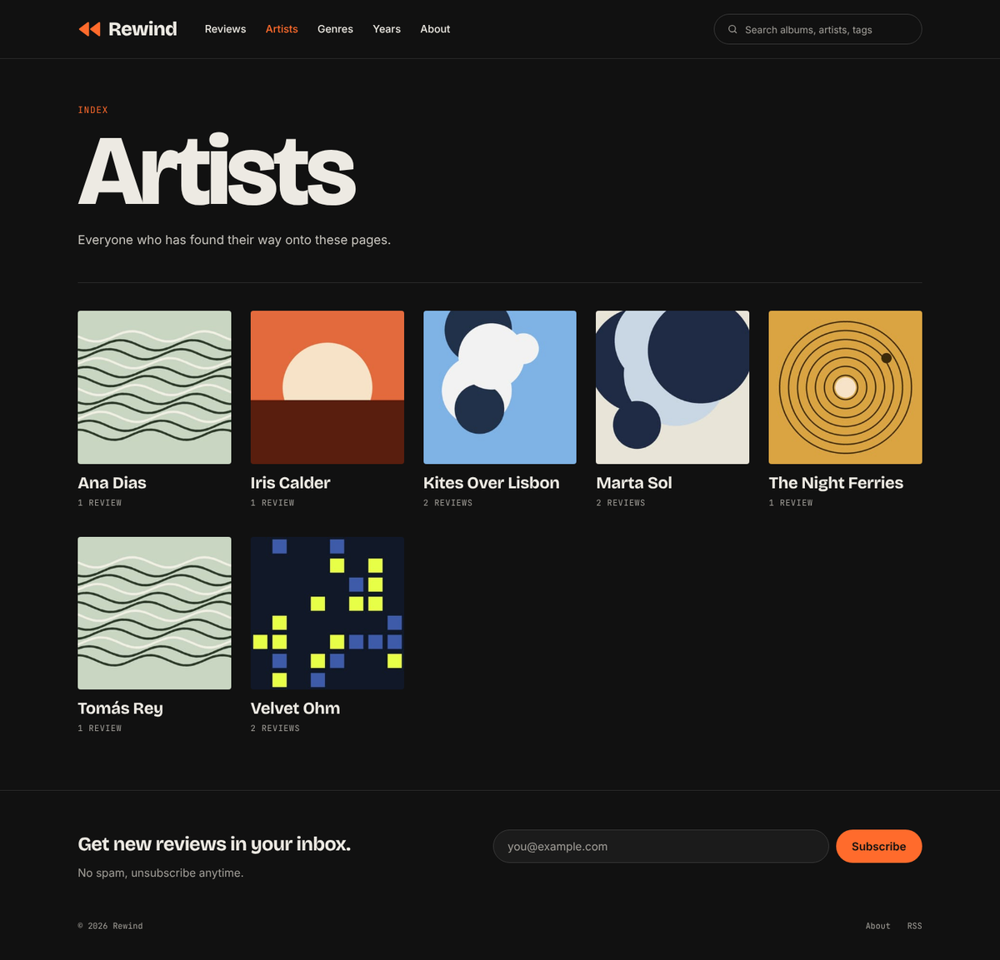
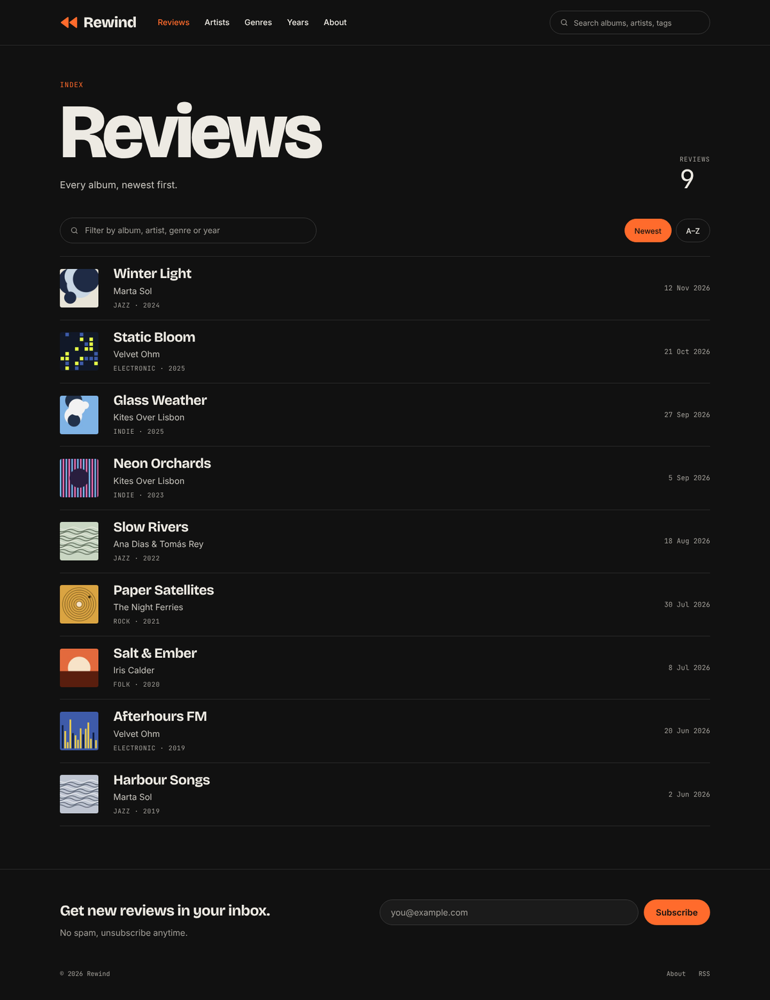
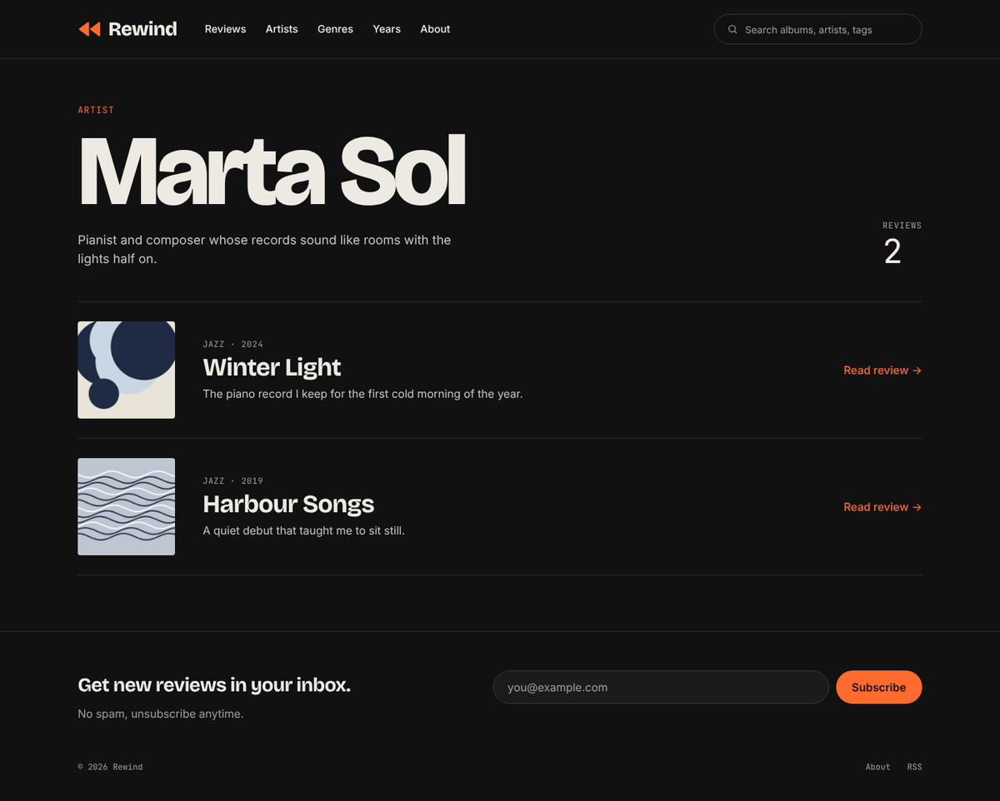
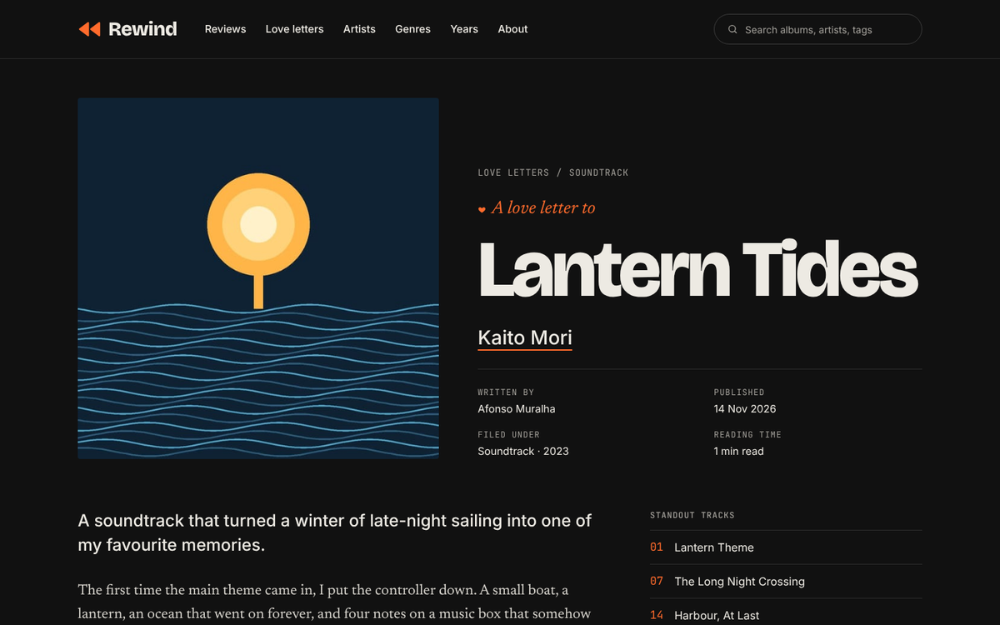
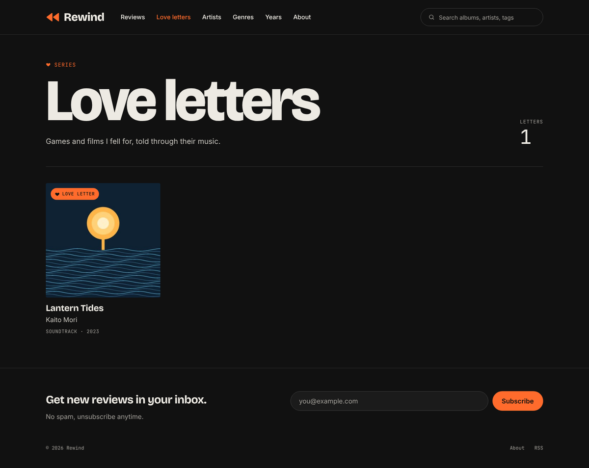
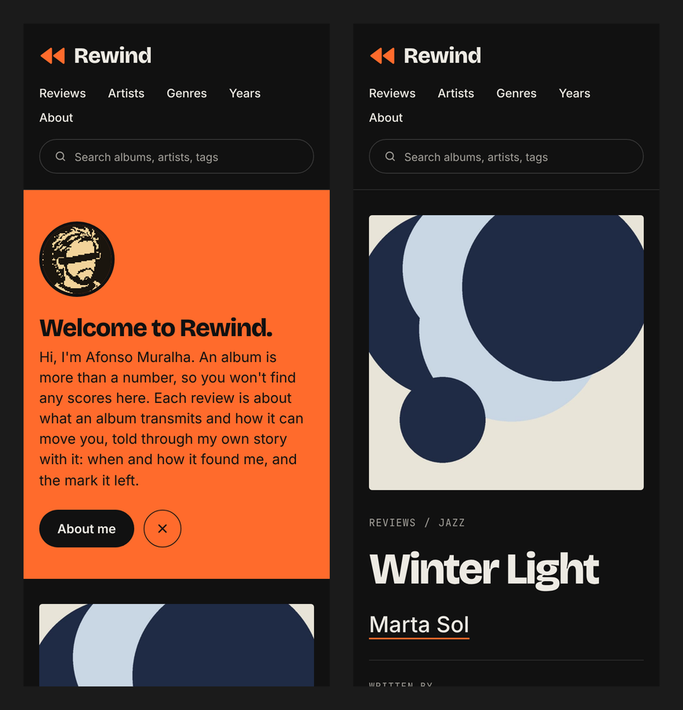
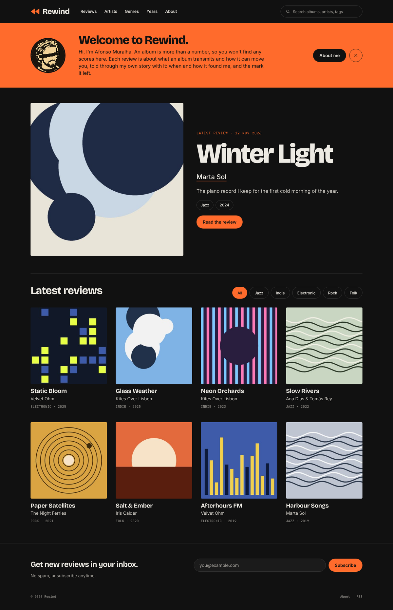

# Rewind

**A Ghost theme for album reviews about feelings, not scores.**

Rewind is a self-hosted blog for writing about albums the personal way: what a record transmits, how it can move you, and the story of when and how it found you. No ratings, no star counts.

This repository contains everything needed to run it:

- **[`rewind.zip`](rewind.zip)**: the theme, ready to upload to Ghost
- **`theme/`**: the Rewind theme's source for [Ghost](https://ghost.org) 6
- **`deploy/`**: a Docker Compose setup (Ghost + MySQL) meant to sit behind a reverse proxy such as Nginx Proxy Manager
- **`docs/`**: install guide, author guide and review tracker
- **`.github/`**: CI that checks and packages the theme, optional auto-deploy, and issue templates



---

## Features

- **Welcome banner** with your avatar and intro text, editable from Ghost admin, dismissible by readers
- **Latest review hero** with a large cover, the artist, the excerpt and tags
- **Review pages** with a sidebar for a music embed (**Listen**) and **Standout tracks** with real track numbers, both filled automatically from the post body
- **Artist pages**: every review of an artist on one page, with joint albums shown as "Artist A & Artist B"
- **Love letters**: a series for games and films told through their soundtracks, with its own badge, post header and `/letters/` page
- **Index pages** for Reviews (with live filter, type filter and sorting), Artists, Genres and Years
- **About page** layout with portrait, bio and website link
- **Newsletter signup** using Ghost members (works with Mailgun)
- Built-in Ghost **search**, responsive layout, keyboard and screen-reader friendly
- Accent colour and fonts follow Ghost's **Brand** settings

## Screenshots

> Screenshots use sample reviews of fictional albums with generated cover art.

| Review page | Artists index |
|---|---|
|  |  |

| Reviews index | Artist page |
|---|---|
|  |  |

| Love letter | Love letters index |
|---|---|
|  |  |

| About page | Mobile |
|---|---|
|  |  |

<details>
<summary>Full homepage</summary>



</details>

## Quick start

1. **Run Ghost.** Copy `deploy/` to your server, fill in `.env`, run `docker compose up -d`, and point your reverse proxy at port `8098`.
   See [docs/INSTALL.md](docs/INSTALL.md) for every step, including DNS, HTTPS, email and backups.
2. **Install the theme.** Download [`rewind.zip`](rewind.zip) (on GitHub: open it, then click **Download raw file**), or get it from the latest [release](../../releases). In Ghost admin › **Settings › Design › Change theme › Upload theme**, choose the zip and click **Activate**.
3. **Create the pages** `about`, `reviews`, `letters`, `artists`, `genres` and `years`, and set up navigation. See [docs/INSTALL.md#7-set-up-the-site](docs/INSTALL.md#7-set-up-the-site).
4. **Write your first review** following the [author guide](docs/AUTHOR-GUIDE.md).

## Love letters

Love letters are posts about **games and films you fell for, told through their music**. They sit alongside the album reviews but have their own badge, post header and page.

**One-time setup**

1. Ghost admin › **Tags › New tag**: name `#love-letter` (the `#` makes it an internal tag, hidden from readers; Ghost sets the slug to `hash-love-letter`).
2. **Pages › New page**: title `Love letters`, page URL `letters`. Optional excerpt, e.g. "Games and films I fell for, told through their music." Leave the body empty: the list is generated.
3. **Settings › Navigation**: add `Love letters` → `/letters/`.

**Writing one**

| Field | What to put there |
|---|---|
| Title | The game or film, e.g. *Lantern Tides* |
| Feature image | The soundtrack cover (or the key art) |
| Excerpt | What the music did for you, in a sentence |
| Tags | `Soundtrack` · the composer as an artist tag (`artist-…`) · the year (`year-…`) · `#love-letter` |

Open with a moment in the music, widen out to the story and your memories of it, and close back on the music. **Standout tracks** and the **Listen** embed work just like in reviews.

**What readers see**

- A **Love letter** badge on the cover in every list
- "Latest love letter" on the homepage when a letter is the newest post
- "A love letter to" above the title, and a breadcrumb back to `/letters/`
- All letters on `/letters/`; the Reviews index can switch between **All**, **Reviews** and **Love letters** (`/reviews/#letters` opens it filtered)

More detail in the [author guide](docs/AUTHOR-GUIDE.md#love-letters-games-and-films).

## Documentation

| Doc | For |
|---|---|
| [docs/INSTALL.md](docs/INSTALL.md) | Server setup: Docker, reverse proxy, Cloudflare, Mailgun, theme install, backups, updates, troubleshooting |
| [docs/AUTHOR-GUIDE.md](docs/AUTHOR-GUIDE.md) | Writing reviews: tags, covers, sidebar, multiple artists, publishing checklist, voice |
| [docs/REVIEW-TRACKER.md](docs/REVIEW-TRACKER.md) | Planning which albums to review next |
| [ROADMAP.md](ROADMAP.md) | What's done and what's planned for the theme |
| [CHANGELOG.md](CHANGELOG.md) | Theme version history |
| [theme/README.md](theme/README.md) | Short theme reference (also shipped inside the zip) |

## Repository layout

```
.
├── rewind.zip              Ready-to-upload theme (built from theme/)
├── theme/                  Ghost theme source (this folder is what gets zipped)
│   ├── *.hbs               Templates: index, post, tag, page-about, page-reviews, ...
│   ├── partials/           Cards, hero, tag pills, subscribe form, ...
│   ├── assets/css/         screen.css
│   ├── assets/js/          main.js (banner, sidebar, reviews filter)
│   └── package.json        Theme name, version, image sizes, custom settings
├── deploy/
│   ├── docker-compose.yml  Ghost 6 + MySQL 8, data in ./data
│   └── .env.example        Domain, database passwords, SMTP
├── docs/                   Guides and screenshots
├── scripts/build.sh        Builds dist/rewind.zip
└── .github/                CI workflow and issue templates
```

## Developing the theme

1. Edit files in `theme/`.
2. To see changes live on your own server, uncomment the theme volume in `deploy/docker-compose.yml`, point it at this repo's `theme/` folder, and run `docker compose restart ghost` after each change.
3. Check the theme with Ghost's validator:
   ```bash
   npx gscan theme
   ```
4. Bump `version` in `theme/package.json` and add an entry to [CHANGELOG.md](CHANGELOG.md).
5. Rebuild the zip and commit it, so `rewind.zip` at the repo root always matches `theme/`:
   ```bash
   ./scripts/build.sh      # → rewind.zip (and dist/rewind.zip)
   ```

### Continuous integration

Every push and pull request runs [`.github/workflows/theme.yml`](.github/workflows/theme.yml), which:

- validates the theme with **gscan** (fails on fatal errors)
- builds `rewind.zip` and attaches it to the workflow run
- on a tag like `v1.4.0`, publishes a **GitHub release** with the zip
- optionally **deploys** the theme to your Ghost site on every push to `main` (see [docs/INSTALL.md#auto-deploy-the-theme-from-github](docs/INSTALL.md#auto-deploy-the-theme-from-github))

## Tracking work

- **Theme bugs and ideas:** open an issue with the *Bug report* or *Feature request* template.
- **Albums to review:** open an issue with the *Album to review* template, or keep the list in [docs/REVIEW-TRACKER.md](docs/REVIEW-TRACKER.md). The issue route pairs well with a GitHub Projects board (Backlog → Listening → Drafting → Published).

## License

[MIT](LICENSE) © 2026 Afonso Muralha
